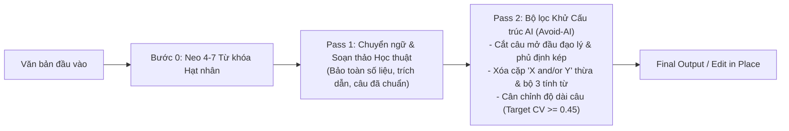

<!-- vlc-disable: ALL -->

# Academic Research, Translation (EN <-> VI) and Graduate Thesis Writing (IEEE, Q1, Luận văn Thạc sĩ/Tiến sĩ)

Bộ kỹ năng (Skill) chuẩn hóa toàn diện quy trình **viết mới, dịch thuật song chiều (`VI -> EN` và `EN -> VI`), hiệu đính, phát hiện và sửa AI writing ("Avoid AI Writing")** cho các công trình nghiên cứu khoa học đỉnh cao:
- **Bài báo Khoa học Quốc tế**: IEEE Conferences/Transactions, ACM, Springer, Elsevier ISI/Scopus Q1, Khảo sát hệ thống chuẩn PRISMA.
- **Luận văn Thạc sĩ & Luận án Tiến sĩ**: Đa ngành CNTT, Khoa học dữ liệu, AI, Xử lý ảnh Y sinh, An toàn thông tin & Điều tra số.

Văn phong chuẩn mực được xây dựng dựa trên các công trình xuất sắc do người thật viết, hoàn toàn thoát ly khỏi "văn mẫu máy móc" của các mô hình ngôn ngữ lớn (LLM), đảm bảo vượt qua các công cụ kiểm tra AI khắt khe nhất (như Grammarly AI Detector, Turnitin, GPTZero).

---

<!-- reference-loading:start -->
Trước khi thực hiện bất kỳ tác vụ dịch thuật, viết mới hoặc hiệu đính nào, hãy đọc và áp dụng các tài liệu tham chiếu tương ứng:
- [references/patterns.md](references/patterns.md): Toàn bộ catalog quy chuẩn 870 dòng của `avoid-ai-writing` (Tier 1A/1B, Tier 2, Tier 3, thẻ quyết định biên tập, cấu trúc câu AI, mẫu mở đầu/kết luận, bộ lọc chuyển ý).
- [references/avoid-ai-patterns.md](references/avoid-ai-patterns.md): Catalog chi tiết các mẫu cấu trúc câu và từ vựng AI song ngữ Anh – Việt và phân tầng rủi ro P0/P1/P2.
- [evals/rewrite/output-contract-scenarios.md](evals/rewrite/output-contract-scenarios.md): 10 kịch bản kiểm thử hành vi chuẩn mực (Clean no-op / Surgical editing, bảo toàn LaTeX, chống ảo giác).
- [references/translation-and-keyword-plan.md](references/translation-and-keyword-plan.md): Quy trình neo từ khóa chính và kỹ thuật dịch 2-Pass (`VI -> EN` & `EN -> VI`).
- [references/banned-phrases.md](references/banned-phrases.md): Danh mục từ cấm, từ so sánh nhất, giật gân và lỗi văn nói tiếng Anh.
- [references/academic-structure.md](references/academic-structure.md): Bố cục đoạn văn Diễn dịch/Quy nạp và cấu trúc IMRAD.
- [references/glossary.md](references/glossary.md): Thuật ngữ song ngữ chuyên ngành đa lĩnh vực.
- [references/latex-guide.md](references/latex-guide.md): Quy chuẩn soạn thảo LaTeX tương thích đa mẫu.
<!-- reference-loading:end -->

---

## 5 Chế độ Thực thi (Execution Modes)

Skill tự động kích hoạt chế độ phù hợp dựa trên câu lệnh tự nhiên của người dùng:

1. **`vi-to-en`** (Kích hoạt khi: *"viết lại tiếng Việt sang tiếng Anh"*, *"dịch sang tiếng Anh"*, *"dịch paper sang tiếng Anh"*):
   - Chuyển ngữ từ tiếng Việt sang tiếng Anh học thuật chuẩn IEEE/Q1.
   - Bắt buộc chạy qua **Quy trình 2-Pass**: Pass 1 dịch chính xác thuật ngữ $\rightarrow$ Pass 2 khử sạch khung câu AI (xóa câu mở đầu đạo lý, xóa xếp chồng cặp `X and/or Y`, đan xen câu ngắn 7–9 từ với câu dài 30–40 từ để đạt $CV \ge 0.45$).
2. **`en-to-vi`** (Kích hoạt khi: *"dịch sang tiếng Việt"*, *"dịch bài báo này cho luận văn"*):
   - Dịch từ tiếng Anh sang tiếng Việt chuẩn văn phong khoa học trong nước.
   - Neo từ khóa chính cố định xuyên suốt, thoát ly hoàn toàn cấu trúc bị động dịch máy, xóa bỏ các từ đệm AI tiếng Việt (*"một cách toàn diện và sâu sắc"*, *"bức tranh tổng thể"*).
3. **`rewrite`** (Mặc định khi người dùng cung cấp một đoạn văn):
   - Viết lại và tinh chỉnh đoạn văn để loại bỏ toàn bộ từ vựng hoa mỹ, lỗi văn nói và khung cấu trúc AI.
   - Xuất kết quả hoàn chỉnh duy nhất dưới mục **Final rewrite**.
4. **`edit`** (Kích hoạt khi người dùng chỉ định tệp cụ thể như `paper/main.tex` hoặc `chapter1.tex`):
   - Chỉnh sửa trực tiếp tại chỗ (**Surgical Edit**).
   - **Bảo toàn 100% các đoạn đã chuẩn của người viết thật**, chỉ can thiệp tối thiểu vào đúng các cụm từ bị lỗi hoặc các câu mang khung cấu trúc của AI.
5. **`detect`** (Kích hoạt khi: *"kiểm tra AI"*, *"audit"*, *"soi lỗi AI"*):
   - Rà soát và liệt kê danh sách các vị trí dính AI-writing theo mức độ `P0`, `P1`, `P2` mà không thay đổi văn bản gốc.

---

## Quy trình Tự Động 2 Bước (2-Pass Convergence Pipeline)

Khi thực hiện dịch thuật hoặc viết lại (`vi-to-en`, `en-to-vi`, `rewrite`, `edit`), AI bắt buộc phải tự hội tụ qua 2 bước trước khi trả kết quả:

- **Bước 0 — Lập Bảng Từ Khóa Chính (Keyword Plan)**: Xác định 4–7 từ khóa chuyên môn cốt lõi và khóa cố định một cách diễn đạt duy nhất xuyên suốt bài (Zero-Synonym-Drift).
- **Pass 1 — Soạn thảo / Chuyển ngữ Học thuật**: Dịch chính xác nội dung kỹ thuật, giữ nguyên cấu trúc toán, bảng biểu và lệnh trích dẫn (`\cite`, `\citep`).
- **Pass 2 — Bộ lọc Khử Cấu trúc AI (Avoid-AI Filter)**:
  1. *Cắt bỏ câu mở đầu giảng đạo lý* (`Truism opener`): Đi thẳng trực tiếp vào dữ liệu hoặc hành động của đề tài.
  2. *Giải tán các cặp ghép song hành* (`Binomial stacking`): Giảm mật độ các cặp `A and/or B` về mức tối đa 1–2 cặp/đoạn, thay bằng 1 danh từ cụ thể.
  3. *Loại bỏ câu thú nhận kiểu chatbot* (`Cutoff disclaimers`): Thay các câu kiểu `"although we do not have the details on..."` bằng thông tin khách quan trong ngoặc đơn.
  4. *Cân chỉnh độ biến thiên chiều dài câu (`Burstiness Calibration`)*: Trộn 1 câu ngắn (7–9 từ) bên cạnh 1 câu phức nhiều mệnh đề (30–42 từ) để đạt $CV \ge 0.45$.

---

## Phương Pháp Dịch Cầu Song Ngữ (Bilingual Roundtrip Triangulation: `EN -> VI -> EN`)

Khi viết lại bài báo tiếng Anh gốc (`paper/main.tex`) để vừa đạt chuẩn học thuật quốc tế vừa **vượt qua 100% các công cụ kiểm tra AI (Grammarly, Turnitin, GPTZero)**:
1. **Tại sao viết lại trực tiếp (EN -> EN) hay bị Grammarly bắt 100% AI?**
   - Khi chỉnh sửa trực tiếp trên tiếng Anh, các LLM thường tự động "thổi phồng" bằng từ vựng Latinh trừu tượng (`systematically evaluates empirical literature across three core dimensions`, `acquisition modalities`, `taxonomic consistency`, `systematic framework tailored for...`), dùng mẫu liệt kê cơ học (`First,... Second,... Third,...`), chèn dấu gạch ngang nối ý lỏng lẻo (`—`), và tạo nhịp câu đều đều. Các mẫu câu này lập tức kích hoạt bộ dò AI của Grammarly lên mức 100%.
2. **Quy trình Dịch Cầu Song Ngữ 2 Bước:**
   - **Bước 1 (`EN -> VI` Tự nhiên)**: Dịch văn bản gốc sang tiếng Việt tự nhiên, khúc chiết, mạch lạc như một nhà nghiên cứu đang trao đổi học thuật thực thụ. Bước này lập tức bóc tách sạch lớp vỏ từ vựng Latinh sáo rỗng và các khuôn mẫu câu robot của tiếng Anh.
   - **Bước 2 (`VI -> EN` Đanh thép)**: Dịch ngược từ bản tiếng Việt tự nhiên sang tiếng Anh học thuật:
     - Dùng động từ hành động trực tiếp và chủ ngữ kỹ thuật cụ thể.
     - Phá vỡ chuỗi liên từ liệt kê cơ học (`First/Next/Finally`), mở đầu bằng câu chủ đề dẫn dắt tự nhiên.
     - Đan xen câu ngắn dứt khoát (4–8 từ) bên cạnh câu phân tích chuyên sâu (20–35 từ) để đạt độ biến thiên nhịp điệu cao ($CV \ge 0.45$).
     - Loại bỏ toàn bộ dấu gạch ngang chữ `—` nối ý tùy tiện.
     - Bảo toàn nguyên vẹn 100% các nhãn trích dẫn `\cite{...}`, `\citep{...}`, `\ref{...}` và số liệu thực nghiệm.

---

## Hợp đồng Biên tập & 8 Điều Cấm Tự Nhét (Never-Inject Guardrails)

Để đảm bảo văn bản giữ trọn tính chân thực và không bị biến dạng thành văn mẫu AI, AI **tuyệt đối không được tự ý đưa thêm** các yếu tố sau vào bài viết:

1. **CẤM TỰ NHÉT câu mở đầu triết lý/đạo lý (`Formulaic Truism Opener`)**:
   - ❌ Không tự thêm: *"Research on X is not straightforward; it requires strict ethical oversight..."* hay *"Khả năng khái quát hóa dữ liệu giữ vai trò vô cùng quan trọng..."*.
2. **CẤM TỰ NHÉT câu nhận định/cảm thán cuối đoạn (`Unverified Closing Commentary`)**:
   - ❌ Không tự thêm: *"Điều này mở ra một hướng đi đầy hứa hẹn trong tương lai..."*, *"This paves the way for groundbreaking advances..."*, *"Thật thú vị khi nhận thấy..."*. Bản gốc có bao nhiêu ý thì diễn đạt đúng bấy nhiêu ý, nêu xong số liệu thực nghiệm là dừng dứt khoát.
3. **CẤM TỰ NHÉT cấu trúc Phủ định – Khẳng định đối xứng (`Negative Parallelism`)**:
   - ❌ Không tự thêm: *"It is not just X — it is Y"*, *"Không đơn thuần là X mà còn là Y"*.
4. **CẤM TỰ NHÉT xếp chồng cặp ghép `X and/or Y` & Bộ 3 tính từ (`Binomial/Tricolon Stacking`)**:
   - ❌ Không lặp đi lặp lại công thức kết thúc mọi câu bằng: `A and B`, `C or D`, hoặc `toàn diện, sâu sắc và đa chiều`.
5. **CẤM TỰ NHÉT câu thú nhận thiếu dữ liệu kiểu Chatbot (`Narrated Candor`)**:
   - ❌ Không tự viết: *"although we do not have the details on the issuing body..."*, *"cần phải thẳng thắn thừa nhận rằng..."*.
6. **CẤM TỰ NHÉT dấu gạch ngang kịch tính (`Em-dash Splice`) & Băm câu cụt (`Staccato Fragments`)**:
   - Không tự ý chèn dấu gạch ngang `—` để làm màu kịch tính; không băm nhỏ câu văn học thuật thành các mảnh vụn cộc lốc.
7. **CẤM TỰ Ý ĐỔI TỪ KHÓA CHÍNH SANG TỪ ĐỒNG NGHĨA LẠ (`Synonym Cycling`)**:
   - Luôn lặp lại nhất quán từ khóa hạt nhân đã chốt ở Bước 0 từ đầu đến cuối văn bản.
8. **CẤM TỰ NHÉT câu mở đầu tường thuật đề cương/mục lục (`Meta-Discourse / Syllabus Outline Tell` — `ACAD014`)**:
   - ❌ Không tự viết: *"Our analysis focuses on three components: A, B, and C"*, *"Each entry reports publisher metadata..."*, *"The breakdown spans three primary categories..."*, *"Mục này tập trung vào ba khía cạnh chính..."*.
   - ✅ Thay vào đó: Đi thẳng vào **luận điểm khoa học thực nghiệm** (Substantive Empirical Insight) hoặc dùng cấu trúc phân đoạn chức năng mộc mạc (`ACAD016`).
9. **CẤM CHUỐT BÓNG TU TỪ & MỆNH ĐỀ PHÂN TỪ NỐI TIẾP (`Anti-Hyper-Polishing & Participle Chaining` — `ACAD015`)**:
   - ❌ Không dùng các cấu trúc phân từ nối tiếp mà LLM hay lạm dụng: *"..., requiring authors to address..."*, *"..., leaving X as the only option..."*, *"play a defining role here"*, *"In turn, task demands dictate whether..."*.
   - ✅ Khuyến khích **Mẫu Phân Nhóm Khảo Sát Hệ Thống (`ACAD016`)**: Dùng cụm dẫn ý chức năng mộc mạc (*"In terms of datasets, this encompasses..."*, *"For research tasks, it covers..."*) và giữ nguyên các từ viết tắt chuyên ngành tự nhiên (*"DNNs"*, *"stat-based baselines"*, *"clinical medical exams"*).
10. **CẤM DÙNG DẤU HAI CHẤM ĐỂ LIỆT KÊ & CÂU CỤT GIẢ TẠO (`Anti-Colon-List & Staccato Tell` — `ACAD017`)**:
   - ❌ Cấm cấu trúc hai chấm liệt kê danh từ song hành kiểu robot hoặc chèn các câu ngắn giả tạo 4–6 từ cụt lủn chỉ để ép tăng chỉ số CV (*"Most papers focus on text."*, *"Sharing these collections is rare."*).
11. **CHIẾN LƯỢC CHỐNG THIÊN LỆCH DỊCH THUẬT RLHF TỪ VIỆT SANG ANH (`VI-to-EN Anti-RLHF Translation Policy` — `ACAD018`)**:
   - Khi dịch từ tiếng Việt sang tiếng Anh, LLM mặc định chọn **khung xương cú pháp có xác suất cao nhất (Low-Perplexity RLHF Skeleton)** khiến các bộ phân loại sâu (QuillBot/Grammarly RoBERTa) báo 100% AI dù không có từ vựng hoa mỹ. Bắt buộc áp dụng **6 Quy tắc Cú pháp Người Thật**:
     1. **Đặt `in Figure~\ref{...}` / `in Table~\ref{...}` ở cuối câu bị động**: Viết *"The analysis of 51 selected studies are presented as a pie chart in Figure~\ref{...}"* thay vì *"Figure 1 breaks down / outlines / summarizes..."*.
     2. **Phá vỡ tính song hành từ loại tuyệt đối trong danh sách (Broken POS Parallelism)**: Không viết 5 danh động từ `V-ing` liên tiếp (*detecting A, profiling B, screening C, matching D, parsing E*). Phải trộn lẫn `V-ing` với cụm danh từ `Noun + V-ing`: *"Identifying abusive comments or chat logs, profiling offender behaviors, image screening based on facial or age clues, biometric traits matching in videos, and parsing file system metadata."*
     3. **Cấm tuyệt đối Mệnh đề Phân từ Đóng khung đầu/cuối câu (`No Participial Bookends`)**: Cấm mở đầu câu bằng *"Looking at..., Turning to..., Addressing..., Working in the field..."* và cấm kết thúc câu bằng *", representing the largest share"*, *", leaving only..."*, *", explaining why..."*, *", leading authors to..."*. Thay bằng *"Among all the target media, ..."* và nối mệnh đề bằng `and` / `because`.
     4. **Dùng động từ giản dị chưa nén (`Un-compressed Plain Verbs`)**: Thay các động từ cliché của AI (*"dominates the corpus"*, *"stems largely from"*, *"draws heavily from"*, *"centers on"*, *"poses substantial hurdles"*) bằng động từ đời thực của nhà nghiên cứu: *"has the most research (38 papers, 74.5%)"*, *"have been shown to be able to perform"*, *"can include"*, *"is mainly due to"*.
     5. **Không lạm dụng `, while` để nối hai vế câu**: LLM nối gần như mọi cặp số liệu hoặc tác giả bằng `, while`. Hãy nối trực tiếp bằng `and` hoặc tách câu: *"Image analysis 13.7% (7 papers) and video examination or digital file system forensic each accounts for roughly 5.9% (3 papers) on average."*
     6. **Ưu tiên từ vựng đời thường & từ ghép tách rời**: Dùng *"facial or age clues"* (thay cho *cues*), *"in videos"* (thay cho *in video streams*), *"file system"* (2 từ rời thay cho *filesystem*), *"based on"* (thay cho *via/through*).

---

## 9 Trụ cột Học thuật Cốt lõi

### 1. Nguyên tắc "Zero-Superlative" (Tuyệt đối không dùng từ "nhất")
Trong nghiên cứu khoa học, không có thuật toán hay giải pháp nào là "hoàn hảo" hoặc "tốt nhất" trong mọi điều kiện (Định lý No Free Lunch). Mọi kết luận đều phải dựa trên quan sát thực nghiệm có điều kiện biên rõ ràng.
- **CẤM TUYỆT ĐỐI**: `nhất`, `tốt nhất`, `hoàn hảo`, `tuyệt đối`, `số 1`, `hàng đầu`, `đột phá nhất`, `vượt trội nhất`, `tối ưu nhất`, `triệt để`.
- **Thay thế bằng**: Số liệu định lượng cụ thể hoặc nhận định so sánh tương đối có căn cứ:
  - ❌ *"Mô hình đạt độ chính xác cao nhất hiện nay."*
  - ✅ *"Mô hình đạt độ chính xác 94,18\%, cao hơn so với các phương pháp đối chứng trên cùng tập kiểm thử."*
  - ❌ *"Đây là hướng tiếp cận hoàn hảo nhất."*
  - ✅ *"Đây là phương pháp tiêu chuẩn mang lại hiệu quả ổn định."*
- Danh mục chi tiết: **[references/banned-phrases.md](references/banned-phrases.md)**.

### 2. Nguyên tắc "Khách quan hóa & Mực thước" (Không nghiêm trọng hóa)
Không sử dụng ngôn từ giật gân, hoang mang, phóng đại hoặc mang tính cảm xúc cá nhân. Mức độ nguy hại của bệnh lý, tội phạm mạng hoặc sai lệch kỹ thuật phải được diễn đạt bằng thuật ngữ chuyên môn và thống kê.
- **CẤM TUYỆT ĐỐI**: `vô cùng nghiêm trọng`, `cực kỳ nguy hiểm`, `thảm họa`, `đe dọa nghiêm trọng tới sự sống còn`, `hoàn toàn bế tắc`, `vấn nạn nhức nhối`.
- **Thay thế bằng**: Văn phong học thuật điềm đạm, định lượng:
  - ❌ *"Bệnh Alzheimer là thảm họa vô cùng nghiêm trọng với loài người."*
  - ✅ *"Các bệnh lý thoái hóa thần kinh mạn tính đã và đang trở thành thách thức to lớn đối với hệ thống y tế công cộng~\cite{reitz_global_2023}."*
  - ❌ *"Rò rỉ dữ liệu là sai lầm chết người phá hủy toàn bộ kết quả."*
  - ✅ *"Song các kết quả này tiềm ẩn nguy cơ bị thổi phồng do những hạn chế trong phương pháp luận thực nghiệm."*

### 3. Cấu trúc đoạn văn chuẩn học thuật (Mở hoặc kết đoạn luôn là Luận điểm)
Mỗi đoạn văn là một khối lập luận trọn vẹn (gồm 3–7 câu). Không ngắt đoạn cụt lủn kiểu bài viết mạng xã hội.
- **Mô hình Diễn dịch (Deductive)**: Mở đoạn là **Luận điểm trung tâm (Topic Sentence)** $\rightarrow$ Các câu thân đoạn triển khai luận cứ, dẫn chứng thực nghiệm, cơ chế nhân-quả, trích dẫn tác giả tiền nhiệm (`~\cite{...}`).
- **Mô hình Quy nạp (Inductive)**: Các câu thân đoạn phân tích bối cảnh, số liệu, đối chiếu $\rightarrow$ Câu kết đoạn đúc kết thành **Luận điểm kết luận (Concluding Claim)**.
- **Mô hình Tổng - Phân - Hợp**: Mở đoạn khái quát $\rightarrow$ Thân đoạn phân tích đa diện $\rightarrow$ Kết đoạn chốt ý và chuyển tiếp sang phần tiếp theo.
- Hướng dẫn cấu trúc & mẫu câu: **[references/academic-structure.md](references/academic-structure.md)**.

### 4. Dòng chảy câu cú chuẩn mực, không ngắt dòng ngẫu nhiên
- **Tuyệt đối không ngắt dòng ngẫu nhiên**: Một đoạn văn phải là một khối văn bản liền mạch. Không ngắt dòng giữa chừng câu hoặc chia nhỏ mỗi câu thành một đoạn riêng biệt.
- **Cấu trúc ngữ pháp hoàn chỉnh**: Đầy đủ cụm Chủ ngữ – Vị ngữ – Bổ ngữ. Tránh câu què, câu cụt, hoặc đặt dấu phẩy tùy tiện ngắt giữa chủ ngữ dài và vị ngữ.
- **Hệ thống liên từ học thuật kết nối ý** (dùng vừa phải, không lạm dụng ở đầu mọi câu):
  - *Chuyển tiếp/Nhượng bộ*: `Mặc dù vậy,`, `Tuy nhiên,`, `Ngược lại,`, `Song,`.
  - *Bổ sung luận cứ*: `Bên cạnh đó,`, `Đồng thời,`, `Ngoài ra,`, `Song song với đó,`.
  - *Hệ quả/Nguyên nhân*: `Nhằm khắc phục rào cản này,`, `Hệ quả là,`, `Do đó,`, `Chính vì vậy,`.
  - *Tổng kết/Đánh giá*: `Tổng hợp các phân tích trên cho thấy,`, `Kết quả thực nghiệm chứng minh rằng,`.

### 5. Ngôi xưng khách quan (Impersonal Register) & Chuẩn hóa thuật ngữ Đa miền
- **Ngôi xưng**: Tuyệt đối không xưng `tôi`, `bạn` (`you`); không xưng `chúng tôi` trong luận văn tiếng Việt. Sử dụng các thực thể khách quan: `luận văn`, `đề tài này`, `nghiên cứu này`, `mô hình đề xuất`, `các tác giả tiền nhiệm`. (Trong bài báo tiếng Anh nhiều tác giả có thể dùng `we`/`our` giản dị khi mô tả thực nghiệm của nhóm).
- **Thuật ngữ chuyên ngành**: Sử dụng chuẩn xác thuật ngữ AI, Học máy, NLP, An toàn thông tin và Xử lý ảnh MRI y sinh. Giữ nguyên thuật ngữ tiếng Anh gốc phổ quát khi dịch sang tiếng Việt làm tối nghĩa (`backbone, attention, latent space, epoch, batch size, token, embedding, fine-tune, dark web`).
- Từ điển thuật ngữ chuẩn: **[references/glossary.md](references/glossary.md)**.

### 6. Nguyên tắc "Chống ảo giác & Bám sát nguồn gốc" (Zero-Hallucination & Grounded Precision)
Nghiên cứu khoa học và luận văn sau đại học đòi hỏi độ chính xác tuyệt đối đối với mọi tuyên bố kỹ thuật:
- **CẤM TUYỆT ĐỐI BỊA ĐẶT / SUY DIỄN**: Không tự ý thêm bớt các chi tiết giải phẫu học, danh sách mô, nguồn nhiễu, hay tự suy diễn thêm nhận định khi tài liệu gốc không đề cập.
- **PHÂN ĐỊNH RÕ TỪ "HỆ THỐNG" VÀ "TỰ ĐỘNG"**:
  - Trong mô tả giải thuật/mô hình đơn lẻ: Không dùng *"hệ thống thực hiện..."*, *"hệ thống tiếp nhận..."*, *"tự động trích xuất..."*. Thay bằng tên thực thể kỹ thuật rõ ràng: `mô hình đề xuất`, `mạng nơ-ron`, `thuật toán`, `phương pháp`, `bộ mã hóa`, `quy trình`.
  - **Ngoại lệ hợp lệ**: Giữ nguyên từ `"hệ thống"` trong các thuật ngữ chuẩn như `tổng quan tài liệu hệ thống (systematic review)`, `có hệ thống (systematically)`, `hệ thống bảo vệ trẻ em`, `hệ thống phân loại tệp`, `hệ thống y tế công cộng`, `hệ quy chiếu`, `hệ tọa độ`.
- **CẤM MỞ ĐẦU & KẾT ĐOẠN SÁO RỖNG DẠNG DIỄN VĂN**: Cấm các câu mở đầu triết lý chung chung. Luôn đi thẳng trực diện vào bài toán kỹ thuật, dữ liệu nguồn và mục tiêu xử lý.
- **TƯƠNG THÍCH MACRO LATEX CỦA TÀI LIỆU GỐC**:
  - Nếu tài liệu có dùng gói `acronym` (như luận văn): Khi một tổ chức hay bộ dữ liệu đã được giải nghĩa ở các chương trước (như ADNI, AIBL), ở các chương sau chỉ dùng macro `\acs{ADNI}`.
  - Nếu tài liệu **không** khai báo gói `acronym` (như bài báo `article` trong `paper/main.tex`): Viết trực tiếp chữ viết tắt `CSAM`, `CNN`, `LSTM` sau lần định nghĩa đầu tiên; tuyệt đối không chèn `\acs{...}` gây lỗi biên dịch. Giữ nguyên lệnh trích dẫn gốc của bài (`\cite{...}` hoặc `\citep{...}`).

### 7. Nguyên tắc "Mô tả kiến trúc học sâu chuyên sâu" (Zero-Manual-Specs & No-Itemize Abuse)
Mô hình học sâu trong paper IEEE/Q1 và luận văn Thạc sĩ/Tiến sĩ là một tiến trình toán học biến đổi không gian đặc trưng ($X \rightarrow Z \rightarrow Y$), không phải là một bảng kê thiết bị phần cứng hay sổ tay cài đặt phần mềm:
- **CẤM CÂU DẪN DẠNG SỔ TAY KỸ THUẬT**:
  - ❌ *"Kiến trúc mạng được thiết lập với các thông số cấu hình chi tiết:"*
  - ✅ *"Bộ mã hóa áp dụng kiến trúc phân cấp đa giai đoạn nhằm chuyển hóa dần biểu diễn từ không gian điểm ảnh cục bộ sang không gian đặc trưng ngữ nghĩa mức cao."*
  - Lưu ý từ `"tuần tự"`: Trong mạng thị giác phân tầng không dùng *"tổ chức tuần tự qua các tầng"* (thay bằng `tiếp nối`, `chuỗi khối tiếp nối`); chỉ dùng `"tuần tự"` đúng bản chất khi mô tả dữ liệu chuỗi/văn bản và mạng hồi quy RNN/LSTM (*phụ thuộc chuỗi tuần tự — sequential dependencies*).
- **CẤM LẠM DỤNG `itemize` ĐỂ LIỆT KÊ VỤN VẶT CÁC TẦNG MÔ HÌNH**:
  - Không băm nhỏ mô hình học sâu thành một danh sách gạch đầu dòng (`\begin{itemize}`) liệt kê từng tầng như cấu hình máy tính. Trình bày thành các đoạn văn học thuật liền mạch (academic prose).

### 8. Nguyên tắc "Lên Plan & Neo Từ khóa Chính Xuyên suốt" (Pre-Writing Keyword Plan)
Trước khi dịch hoặc viết một bài báo/chương luận văn, bắt buộc thực hiện bước **Lập Bảng Từ khóa Chính (Core Keywords)**:
- **Chọn 4–7 từ khóa chính** của bài (tên bài toán, tên phương pháp/mô hình, loại dữ liệu, quy chuẩn đánh giá) và chốt **1 cách dịch cố định duy nhất**.
- **Lặp lại từ khóa chính một cách tự nhiên xuyên suốt bài**: Trong văn học cần tránh lặp từ, nhưng trong văn bản khoa học **phải lặp lại đúng từ khóa chính** từ Tóm tắt $\rightarrow$ Mở đầu $\rightarrow$ Phương pháp $\rightarrow$ Thực nghiệm $\rightarrow$ Kết luận. Tuyệt đối không tự ý đổi sang các từ đồng nghĩa lạ làm lệch nghĩa chuyên môn.
- Chi tiết cách lập plan từ khóa: **[references/translation-and-keyword-plan.md](references/translation-and-keyword-plan.md)**.

### 9. Nguyên tắc "Mực thước Khoa học — Phát hiện và Sửa AI Writing & Loại trừ Từ ngữ Suồng sã" (Anti-AI Writing & Academic Formality)
Mục tiêu là văn bản đạt chuẩn mực khoa học quốc tế, phát hiện và sửa toàn diện các dấu hiệu AI writing, vượt qua các công cụ quét AI (Grammarly AI Detector, Turnitin, GPTZero) và tuyệt đối không dùng từ ngữ suồng sã:
- **BẢO TOÀN CÂU ĐÃ CHUẨN (Surgical Editing)**: Giữ nguyên cấu trúc và nhịp câu tự nhiên của tác giả; chỉ sửa đúng từ bị lỗi hoặc các câu mang cấu trúc máy móc của AI.
- **LOẠI BỎ TRIỆT ĐỂ TỪ NGỮ SUỒNG SÃ, SỖ SÀNG, KHẨU NGỮ ĐỜI THƯỜNG (`ACAD013`)**:
  - Tuyệt đối cấm các từ suồng sã, thiếu mực thước: `khử mùi`, `bóc phốt`, `chém gió`, `phán bừa`, `ngon ăn`, `dễ ợt`, `ăn đứt`, `đè bẹp`, `bó tay`, `chịu chết`, `vọc vạch`, `xịn sò`, `nói trắng ra`, `thẳng thắn mà nói`.
  - Thay bằng văn phong học thuật mực thước: *"phát hiện và sửa AI writing"*, *"phát hiện sai lệch"*, *"nhận định thiếu căn cứ thực nghiệm"*, *"đạt hiệu năng vượt trội có ý nghĩa thống kê"*.
- **TRIỆT PHÁ 5 DẤU HIỆU CẤU TRÚC AI**:
  1. *Cắt bỏ câu mở đầu giảng đạo lý + Phủ định kép*.
  2. *Giải tán việc kết thúc mọi câu bằng cặp đối xứng `X and/or Y` hoặc bộ 3 tính từ*.
  3. *Loại bỏ câu thú nhận thiếu thông tin kiểu Chatbot*.
  4. *Cấm các từ vựng làm màu của AI (Tier 1A/1B và Tier 2 cluster)*.
  5. *Đan xen câu ngắn (7–9 từ) và câu dài (30–40 từ) để tạo độ biến thiên chiều dài câu cao ($CV \ge 0.45$)*.
- Chi tiết: **[references/avoid-ai-patterns.md](references/avoid-ai-patterns.md)** và **[references/patterns.md](references/patterns.md)**.

---

## Định Dạng Kết Quả Đầu Ra (Output Format)

Khi hoàn thành tác vụ, phản hồi theo định dạng chuẩn:

### 1. Ở chế độ `rewrite`, `vi-to-en`, hoặc `en-to-vi`
- **Final rewrite**: Trả về toàn bộ đoạn văn/văn bản đã được xử lý hoàn chỉnh (đã qua Pass 2 Khử AI).
- **Changes**: Tóm tắt ngắn gọn các can thiệp chính (từ khóa neo giữ, cấu trúc AI đã phá bỏ, thay đổi nhịp câu).
- **Verification**: Báo cáo kiểm định:
  - *Editing passes*: Số lượt biên tập (ví dụ: `2/2 passes (initial draft + de-ai polish)`).
  - *Checks*: Kết quả chạy linter (`validate_copy.py` / `ACAD001–ACAD012`).
  - *Residuals*: Các thuật ngữ kỹ thuật được bảo toàn nguyên bản.
  - *Stop reason*: `Convergence achieved (clean human cadence)`.

### 2. Ở chế độ `edit` (Sửa trực tiếp file `.tex` / `.md`)
- **Edits made**: Danh sách các vị trí đã can thiệp trong file (`line X: before -> after`).
- **Verification**: Xác nhận nội dung đã lưu và kết quả kiểm tra linter trên file.

### 3. Ở chế độ `detect` (Chỉ quét lỗi)
- **Issues found**: Phân loại theo `P0`, `P1`, `P2` trích dẫn rõ đoạn văn bị dính AI.
- **Assessment**: Nhận định nguy cơ bị Grammarly/Turnitin bắt cờ AI.
